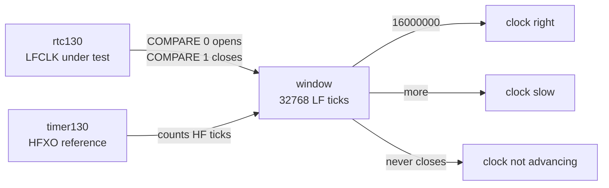
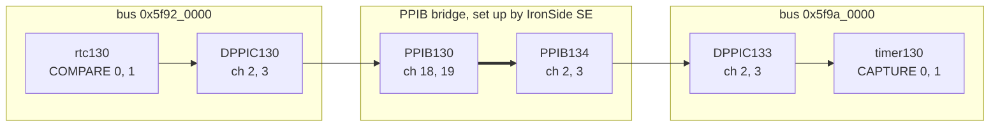
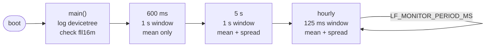
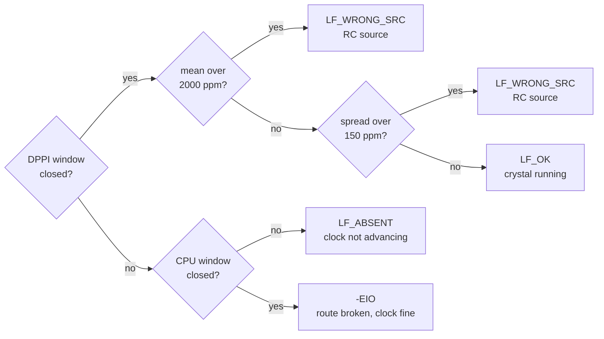

# lfclk_probe

An `LFCLK` health probe for the `nRF54H20`. 
It counts `LFCLK` against an `HFXO`-derived reference and tells you whether the low frequency clock is running
on the crystal, on an RC source, or not at all.

`clock_control` resolves 20 ppm on this board, but that number is read back out of `BICR`, and a broken crystal
doesn't edit `BICR`. There aren't convenient XOSTATs to look at.

> [!IMPORTANT]
> I couldn't fully include an xtal failure, so that decision tree is still TBD.
> But it does catch an xtal slowdown/degrade in my testing, below.

# Requirements

Hardware

- `nRF54H20 DK`/`PCA10175`

Software

- `nRF Connect SDK v3.4.0` (`v3.4.0-99553055607b`)
- board target `nrf54h20dk/nrf54h20/cpuapp`
- sample memory: ` flash / RAM : 58260 B / 15656 B `

# Overview

`rtc130` counts `LFCLK`. `timer130` counts `fll16m` in bypass, which is `HFXO`
straight through. `RTC COMPARE` opens and closes a window N LF ticks wide, and
the HF count inside it gives the ratio.

The DPPI window has `RTC COMPARE` trigger `TIMER CAPTURE` at both edges. The CPU
window reads both counters in software and is the fallback. Logs and function
names call a window a gate, and the CPU window the software gate.



The counters sit on different peripheral buses, so the event crosses a PPIB
bridge.



Boot sequence:



600 ms is the board's declared `LFXO` startup budget. 5 s clears the `LFXO`
calibration window. The poll exists because nothing re-evaluates a satisfied
clock request. Spread is 64 windows of 32 LF ticks each.

The early probe judges the mean only. At 20 ms into boot the spread read a
220 HF tick range against 2 once settled, so judging it early raises false alarms.

Decision per probe:



The thresholds are `LF_PPM_REJECT` and `LF_PPM_SPREAD_REJECT` in `src/lf_probe.h`.

A bad verdict latches a fault flag. Two good readings clear it.

## SoC resources

| resource | what sample uses |
| --- | --- |
| `RTC` | `rtc130`, CC 0 and 1 |
| `TIMER` | `timer130`, CC 0 and 1 |
| DPPI | channels 2 and 3 on `DPPIC130` and `DPPIC133` |
| PPIB | `PPIB130` ch 18 and 19 to `PPIB134` ch 2 and 3 |
| `fll16m` | held for the window only, released after |
| threads | one, 1024 B stack, `K_PRIO_PREEMPT(10)` |
| pins | N/A |


Leaves you `rtc131`, `timer131` through `timer137`, and DPPI channels 0, 1, and
4 through 7.

# Building and Running

```
west build -b nrf54h20dk/nrf54h20/cpuapp
west flash
```

Console is `uart136` on VCOM0. (or `/dev/ttyACM0`.)

rate: `115200,8,n,1`

# Example Output

Every verdict below came off the shipping build on hardware.

| verdict | condition | how it was produced |
| --- | --- | --- |
| `LF_OK` | crystal running | stock `BICR`, 14 boots |
| `LF_WRONG_SRC` | RC source | `BICR` `lfosc.source: LFRC`, 9 boots |
| `LF_ABSENT` | LF counter not advancing | `counter_stop(rtc130)` |
| `-EIO` | event route broken, clock fine | `rtc130` CC contention clearing `EVTEN` |

## a healthy board

Stock `BICR`, crystal fitted and working.

```
*** Booting nRF Connect SDK v3.4.0-99553055607b ***
*** Using Zephyr OS v4.4.0-bf801e4e3d19 ***
[00:00:00.020,340] <inf> lf_probe: lf_probe on nrf54h20dk@0.9.0/nrf54h20/cpuapp
[00:00:00.020,345] <inf> lf_probe: lfclk nominal      : 32768 Hz
[00:00:00.020,348] <inf> lf_probe: lfrc   declared    : 500 ppm, 200 us startup
[00:00:00.020,350] <inf> lf_probe: lflprc declared    : 1000 ppm, 200 us startup
[00:00:00.020,358] <inf> lf_probe: lf counter rtc@928000 : 32768 Hz
[00:00:00.020,364] <inf> lf_probe: hf counter timer@9a2000 : 16000000 Hz
[00:00:00.020,374] <inf> lf_probe: fll16m resolved    : 16000000 Hz, 30 ppm, precision 0, 850 us startup
[00:00:01.621,079] <inf> lf_probe: early probe: LF_OK at -8 ppm over 32768 LF ticks
[00:00:06.091,353] <inf> lf_probe: late probe: LF_OK at -7 ppm over 32768 LF ticks
[00:00:06.091,362] <inf> lf_probe: late spread 64 gates of 32 LF : mean 15625 HF, mad 0 HF (30 ppm), range 3 HF (192 ppm)
```

The ratio sits within 8 ppm of good across 14 boots
spread between 19 and 58 ppm against a 150 ppm threshold.

`fll16m` resolves at 30 ppm so the ref contributes more uncertainty. 


## probe

Same checks as the late probe, 125 ms window. Captured with
`LF_MONITOR_PERIOD_MS` shortened to 5 s.

```
[00:00:11.287,671] <inf> lf_probe: runtime probe: LF_OK at -1 ppm over 4096 LF ticks
[00:00:11.287,680] <inf> lf_probe: runtime spread 64 gates of 32 LF : mean 15625 HF, mad 0 HF (28 ppm), range 5 HF (320 ppm)
```

Four runtime probes read 20-28 ppm of spread on xtal.

## a crystal dragged off frequency while running

Scope probe held against the `XL1` pad of `X2`, the
32.768 kHz crystal, on a board that had been up 28 minutes.

Reasoning: If [this](https://docs.nordicsemi.com/r/bundle/ngl_001/page/gl/ngl_001/hfxo_test_circuit.html) exists for HFXO, maybe exists for LFXO.


```
00:28:31  runtime probe: LF_OK at -2 ppm over 4096 LF ticks
00:28:35  runtime probe: LF_WRONG_SRC at -335630 ppm over 4096 LF ticks
00:28:35  fault flag latched: LF_WRONG_SRC
00:28:40  fault flag still latched, 1 of 2 good readings
00:28:46  fault flag cleared after 2 good readings
00:28:51  runtime probe: LF_OK at -16 ppm over 4096 LF ticks
00:28:56  runtime probe: LF_WRONG_SRC at -629021 ppm over 4096 LF ticks
00:28:56  fault flag latched: LF_WRONG_SRC
00:29:01  runtime probe: LF_WRONG_SRC at -60842 ppm over 4096 LF ticks
00:29:06  runtime probe: LF_OK at 0 ppm over 4096 LF ticks
00:29:06  fault flag still latched, 1 of 2 good readings
00:29:11  fault flag cleared after 2 good readings
```

Probe counts HF ticks across a fixed number of LF ticks, so a longer window means a slower clock

| reading | implied LFCLK | share of nominal |
| --- | --- | --- |
| -335630 ppm | 24534 Hz | 75% |
| -629021 ppm | 20115 Hz | 61% |
| -60842 ppm | 30889 Hz | 94% |

The crystal did not stop and it did not hand over to `LFRC`. It stayed in the
loop and got pulled up to 12 kHz off resonance by probe capacitance, and the
drag scaled with how hard the pad was contacted. Detected within one probe
interval, 5 s here.

> `LF_PPM_REJECT` caught this. At -629021 ppm it is 300x past the 2000 ppm
> threshold. The spread check exists for the calibrated RC case where the mean
> is useless.

> No spread line appears on those two probes. `lf_verdict_get()` returns
> `LF_WRONG_SRC` from the mean and skips the spread measurement, so no spread
> line is logged.

`XL1` on `X2` is a small pad and wants deliberate contact.

## an LF counter that is not advancing

`counter_stop(rtc130)`, so the counter does not tick. To the probe that is
indistinguishable from a dead `LFCLK`, since the value never changes.

```
[00:00:00.020,446] <wrn> lf_probe: SCRATCH: rtc130 stopped, LF counter will not advance
[00:00:06.622,022] <wrn> lf_probe: early probe: LF_ABSENT, no gate closed
[00:00:06.622,033] <err> lf_probe: fault flag latched: LF_ABSENT
[00:00:12.624,996] <wrn> lf_probe: late probe: LF_ABSENT, no gate closed
```

The early probe reports at 6.62 s. It tried the DPPI window, timed out at 3 s,
fell back to the CPU window, and timed out again. `LF_ABSENT` costs about
6 s per probe and needs both windows to fail.

The late probe ran at 12.62 s, straight after the early one. Its absolute 5 s
deadline had already passed, so it fired on the spot.

> A stopped `LFCLK` cannot be produced from inside. It stops the CPU and
> no application code runs, so that one is recognition only. `LF_ABSENT` turns a
> non-advancing LF counter into a verdict. Without it the probe would hang, or
> print a number it never measured.

## a broken event route

Giving a second consumer a `rtc130` CC channel produces `-EIO` instead of a
verdict. (The Zephyr counter driver manages `EVTEN` for its own alarms and
cleared the `COMPARE` enables the DPPI window needs.)

```
capture failed (err -5) but the software gate read -12 ppm: DPPI route fault, not a clock fault
early probe: undetermined (err -5)
```

The DPPI window died and the CPU window read a healthy clock, so the probe
reports the route. The cause here was register contention. A broken bridge takes
the same branch.

> Do not share `rtc130` or `timer130` with anything else. They are the
> measurement pair. `rtc131` and `timer131` are free and run on the same clocks.

## the fault latch clearing

RC board never recovers, clearing needs a fault that goes away.
`LF_PPM_REJECT` set to 3, between the 1 s window's -6 ppm and the 125 ms window's 0 ppm.
So the boot probes fail and the runtime probes pass.
`LF_MONITOR_PERIOD_MS` shortened to 4 s to make it watchable.

```
[00:00:01.620,866] <inf> lf_probe: early probe: LF_WRONG_SRC at -6 ppm over 32768 LF ticks
[00:00:01.620,876] <err> lf_probe: fault flag latched: LF_WRONG_SRC
[00:00:06.020,793] <inf> lf_probe: late probe: LF_WRONG_SRC at -6 ppm over 32768 LF ticks
[00:00:10.218,240] <inf> lf_probe: runtime probe: LF_OK at 0 ppm over 4096 LF ticks
[00:00:10.218,277] <wrn> lf_probe: fault flag still latched, 1 of 2 good readings
[00:00:14.344,401] <inf> lf_probe: runtime probe: LF_OK at 0 ppm over 4096 LF ticks
[00:00:14.344,439] <inf> lf_probe: fault flag cleared after 2 good readings
```

The second bad reading does not re-log. Two consecutive good readings are needed
to clear, so a caller sampling less often than the probe still sees that
something went wrong.

## a board running on LFRC

`BICR` edited to declare `source: LFRC`, so arbitration has no crystal to pick
and `LFCLK` runs on the internal RC with autocalibration on.

```
[00:00:01.620,834] <inf> lf_probe: early probe: LF_OK at 11 ppm over 32768 LF ticks
[00:00:06.091,169] <inf> lf_probe: late probe: LF_WRONG_SRC at 1 ppm over 32768 LF ticks
[00:00:06.091,179] <inf> lf_probe: late spread 64 gates of 32 LF : mean 15633 HF, mad 3 HF (248 ppm), range 28 HF (1792 ppm)
[00:00:06.091,184] <wrn> lf_probe: late spread 248 ppm exceeds 150 ppm: RC source, not a crystal
[00:00:06.091,191] <err> lf_probe: fault flag latched: LF_WRONG_SRC
```

`LF_WRONG_SRC` on a clock whose mean error is 1 ppm. A calibrated `LFRC` on this
DK reads better than the crystal in absolute terms and clears `LF_PPM_REJECT` by
three decades. The spread condemns it, and it feeds the verdict and the fault
latch.

Both sides were measured on one DK at room temperature, spread taken inside the
probe:

| condition | mean at late probe | spread MAD | verdict |
| --- | --- | --- | --- |
| crystal, 14 boots | -6 to -7 ppm | 19-58 ppm | `LF_OK`, nothing latched |
| LFRC, 9 boots | -33 to +56 ppm | 248-622 ppm | `LF_WRONG_SRC`, latched |

avg overlaps, MAD separates by 4.3x, which is where the 150 ppm
threshold comes from: 2.6x above the worst crystal reading, 1.65x below the
quietest RC one.

> [!NOTE]
> Measure the spread inside the probe, right after the 1 s window. An earlier version
> ran it from a fresh `lf_ref_acquire()` and read 76-110 ppm on the same
> crystal, because it was measuring the HFXO ramp along with the LF source.

# Software Description

| file | what's in it |
| --- | --- |
| `src/lf_probe.h` | every tunable with its origin, `enum lf_verdict`, `struct lf_spread` |
| `src/main.c` | measurement, verdict, spread check, scheduling |
| `boards/nrf54h20dk_nrf54h20_cpuapp.overlay` | counters, `fll16m`, DPPI channels, PPIB route |

| function | job |
| --- | --- |
| `lf_ref_check()` | boot config oracle, resolves accuracy against what the board declares |
| `lf_ref_acquire()` / `lf_ref_release()` | hold `fll16m` at its best accuracy for the window |
| `lf_gate_measure()` | CPU window. Fallback, and the discriminator for DPPI route faults |
| `lf_capture_measure()` | DPPI window |
| `lf_verdict_get()` | DPPI window first, CPU window second, then a verdict |
| `lf_spread_measure()` | cycle-to-cycle deviation over `LF_JITTER_SAMPLES` 32-tick windows |
| `lf_probe_run()` | one scheduled probe plus the fault latch |
| `lf_monitor_thread()` | early probe, late probe, then the hardcoded time based poll |

`lf_verdict_get()` tries the capture first because it's the
accurate one, and only returns `LF_ABSENT` when the CPU window fails too.

misconfigured DPPI route times out exactly like a dead clock, so if the capture
fails while the CPU window still reads a healthy clock you get `-EIO` and the
software reading in the log.
